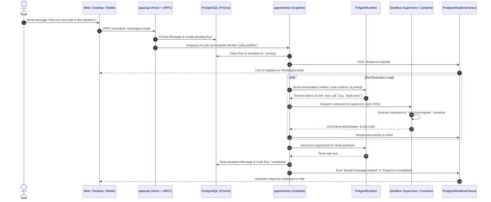

# How Rakazo Works

## Overview

Rakazo is an open-source, self-hosted AI agent platform that powers persistent AI teammates across Web, Electron desktop, and Expo mobile (iOS/Android). Unlike simple chatbot wrappers, Rakazo gives agents persistent memory, scheduled routines, autonomous tool loops, app integrations (Composio, Pipedream, MCP, OpenAPI), and isolated computer environments (Docker, E2B, Daytona, CreateOS, Box, Railway) with headless desktop screens, terminal control, and browser automation.

The platform follows a decoupled client-server architecture:
- **Clients** (Web, Desktop, Mobile) render state, handle voice/chat input, and display live screen streams.
- **Backend API (`apps/api`)** exposes an oRPC/Hono HTTP and WebSocket interface backed by Better Auth and PostgreSQL.
- **Background Worker (`apps/worker`)** manages job queues (Graphile Worker), runs agent execution loops via the Pi runtime (`@rakazo/adapters`), dispatches tools, and streams token/status updates over PostgreSQL `LISTEN`/`NOTIFY`.
- **Sandbox Supervisor (`infra/sandboxes/supervisor`)** orchestrates headless containers (`infra/sandboxes/computer`) providing X11 Fluxbox desktops, virtual screens, and terminal execution.

---

## Operational Readiness & Status

Rakazo is an active, production-grade open source project (licensed Apache 2.0) with comprehensive integration test suites (`packages/testkit`), Docker sandbox suites, Vitest unit tests, Playwright tests, and automated CI pipelines.

### Prerequisites to Run Locally

To spin up Rakazo from source:
1. **Node.js**: 22.22.2+, 24.x, or 26+ (Node 23.x and 25.x are not supported).
2. **Package Manager**: `pnpm` (version 9.15.0 pinned).
3. **Database**: PostgreSQL 16+ instance.
4. **Container Engine**: Docker Engine / Docker Desktop (required for local sandboxes).

### Quick Start Commands

- **Via Prebuilt Docker Images** (no Node/build required):
  ```bash
  mkdir -p rakazo && cd rakazo
  curl -fsSLO https://raw.githubusercontent.com/elie222/rakazo/main/infra/compose/install-images.sh
  bash install-images.sh
  ```

- **From Local Source Checkout**:
  ```bash
  # 1. Start Postgres (with host port published)
  docker compose --env-file .env \
    -f infra/compose/docker-compose.yml \
    -f infra/compose/docker-compose.postgres-host.yml \
    up postgres -d

  # 2. Install dependencies & generate Prisma client
  pnpm install
  pnpm db:generate
  pnpm db:migrate

  # 3. Build sandbox computer container
  pnpm sandbox:build

  # 4. Start API, Worker, Web UI, and Supervisor
  pnpm dev
  ```

---

## Key Concepts

- **Space (`Space`, `SpaceMember`)**: The multi-tenant boundary. All bots, threads, computers, secrets, and permissions belong to a Space.
- **Bot (`Bot`)**: A persistent agent entity with system prompts, assigned models, tools, memory access, and optional voice credentials.
- **Thread & Message (`Thread`, `Message`)**: Conversation sessions between users and one or more bots. Messages support mentions (`@bot`), file attachments, and quotes.
- **Run & Attempt (`Run`, `Attempt`)**: An agent execution cycle triggered by a message or scheduled routine. A run handles multi-step tool calls until completion or interruption.
- **Pi Runtime (`PiAgentRuntime`)**: The core model execution engine in `packages/adapters`. It translates agent prompts, invokes model providers (OpenRouter, Anthropic, OpenAI, local models), handles caching, and structures tool call parsing.
- **Computer & Sandbox (`Computer`, `RunSandbox`)**: Dedicated compute sandboxes where bots run bash commands, control a virtual browser, or interact with a graphical desktop via `xcapture`.
- **Connectors (`InstalledConnectorProvider`, `McpConnector`, `ComposioConnector`)**: Unified tool integration layer exposing external APIs, Model Context Protocol (MCP) servers, and custom scripts to bots.
- **Realtime Fanout (`PostgresRealtimeFanout`)**: A pub/sub broker built on PostgreSQL `NOTIFY`/`LISTEN` that broadcasts message chunks, run state changes, and ticket updates to connected API instances and clients.

---

## How It Works

### End-to-End Execution Flow



### Step-by-Step Architecture

1. **Message Submission & Ingestion**:
   - The user enters a message in the client composer (`apps/web/src` or `apps/mobile/app`).
   - The client invokes the oRPC endpoint `messages.create` on `apps/api/src/router.ts`.
   - The API verifies session permissions via `@rakazo/auth` (Better Auth), persists the message row to PostgreSQL, creates a `Run` record, and enqueues a background job via `GraphileJobPublisher`.

2. **Job Scheduling & Worker Execution**:
   - `apps/worker/src/index.ts` runs a `GraphileJobWorkerHost` polling Postgres.
   - When the worker picks up a run, `createRunExecutor()` in `packages/adapters/src` initializes the execution environment.
   - The worker loads context: thread history, memory documents (`MarkdownMemoryStore`), active bot skills, available tools, and injected secrets (`WorkerSecretStore`).

3. **Agent Runtime Loop (Pi)**:
   - The executor invokes `PiAgentRuntime` (`packages/adapters/src/pi-runtime.ts`), which normalizes prompts across LLM providers (OpenRouter, Anthropic, OpenAI, Groq, Ollama).
   - As tokens stream back, intermediate output is pushed through `PostgresRealtimeFanout`, updating clients in real time via Server-Sent Events (SSE) or WebSocket.
   - If the model requests tool execution, execution branches to the respective provider:
     - **Computer / Terminal**: Sent to `infra/sandboxes/supervisor` (HTTP port 7091) to run inside the Docker container.
     - **Web Browser**: Automated via browser automation inside the sandbox or through parallel web search (`packages/adapters/src/parallel-web.ts`).
     - **Integrations**: Routed through `McpConnector` (MCP servers), `ComposioConnector`, or `PipedreamConnector`.
   - The tool output is appended to the agent session and fed back to Pi until the model signals a final response.

4. **Completion & State Persistence**:
   - The assistant's final response is saved to the `Message` table.
   - Token usage and cost metrics are recorded in `UsageRecord` (`packages/db/src/usage.ts`).
   - If memory extraction is enabled, new facts or instructions are written to `MemoryDocument` revisions.
   - The run completes and clients receive terminal completion events.

---

## Where Things Live

| Directory | Subsystem / Role | Key Technologies |
|---|---|---|
| `apps/api/` | Main backend HTTP server, oRPC router, WebSocket/SSE endpoints, webhook listeners | Hono, oRPC, Better Auth, Prisma |
| `apps/worker/` | Asynchronous background execution worker; runs Pi agent loops and job reconciliation | Graphile Worker, Pi, Node.js |
| `apps/web/` | Web frontend application (chat, bots, routines, ticket board, settings) | React 19, Vite, Tailwind CSS, Base UI |
| `apps/desktop/` | Native desktop wrapper; manages local Docker engines or connects to remote servers | Electron, TypeScript |
| `apps/mobile/` | iOS and Android native apps | Expo Router, React Native, `@expo/ui` |
| `packages/core/` | Platform-neutral domain contracts, shared utilities, prompts, and types | TypeScript |
| `packages/adapters/` | Provider integrations: Pi agent runtime, LLM adapters, MCP, Composio, sandboxes | Pi SDK, Undici, Docker |
| `packages/db/` | Database client, PostgreSQL migrations, Prisma schema, queries | Prisma, PostgreSQL |
| `packages/auth/` | Authentication strategies, SSO/OIDC configuration, session management | Better Auth |
| `packages/ui-web/` | Web design system components and tokens | shadcn/ui on Base UI, CSS tokens |
| `infra/sandboxes/` | Container runtime: supervisor REST daemon and `computer` container with X11 desktop | Docker, Python, Fluxbox, C (`xcapture`) |
| `infra/compose/` | Docker Compose files for local production deployment and server installs | Docker Compose, Bash scripts |

---

## Gotchas

1. **Database Schema & Prisma Generation**:
   - Running `pnpm dev` or building packages requires running `pnpm db:generate` first so that Prisma client types exist in `packages/db/src/generated/prisma`.
2. **Docker Socket & Host Loopback**:
   - When running the supervisor directly on macOS or Linux with Docker Desktop, set `SANDBOX_CONTROL_VIA_LOOPBACK=true` in `.env` so the host supervisor can reach the Docker VM's internal port mappings.
3. **Dedicated Secret Variables**:
   - `BETTER_AUTH_SECRET`, `ENCRYPTION_KEY`, and `SCREEN_PROXY_SECRET` must be distinct, high-entropy hex strings (`openssl rand -hex 16`). Reusing keys or omitting `ENCRYPTION_KEY` will cause encrypted connector credentials to fail to decrypt.
4. **PostgreSQL LISTEN/NOTIFY in Development**:
   - The real-time messaging pipeline relies on native Postgres pub/sub. If using an external pooler like PgBouncer in transaction pooling mode, `LISTEN`/`NOTIFY` connections will break; direct connections to PostgreSQL (port 5432 or host overlay 5433) are required.
5. **No Hosted Vendor Lock-in**:
   - As enforced in repository architecture, no cloud vendor is mandatory. If external providers (Composio, E2B, Fal, ElevenLabs) are omitted, Rakazo falls back to local Docker sandboxes, standard model APIs via Pi, and local artifact stores.
